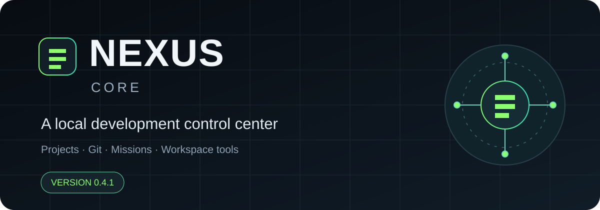
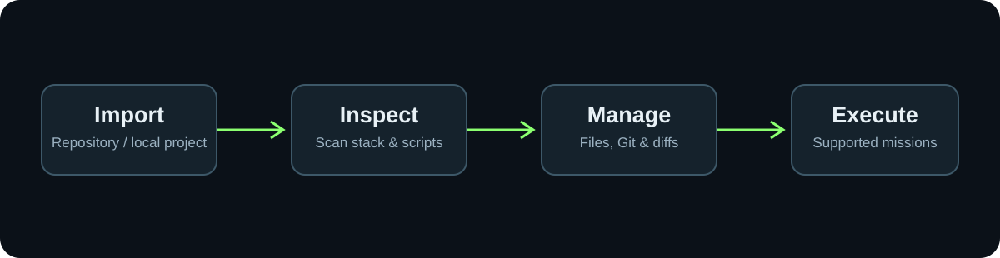

<div align="center">



### A local development control center

Manage project workspaces, inspect repositories, track Git changes, and run supported development missions — from one self-hosted interface.

[**Download v0.4.1**](https://github.com/ansh385/-NEXUS-Core/releases/tag/v0.4.1) · [Report a bug](https://github.com/ansh385/-NEXUS-Core/issues) · [Request a feature](https://github.com/ansh385/-NEXUS-Core/issues)

</div>

---

## About

**NEXUS Core** is a local-first development workspace designed to bring common project-management and development actions into one control center. It runs on your own machine and works with project folders and imported public GitHub repositories.

It is built with native Node.js server capabilities and a lightweight frontend — no framework dependency is required to run NEXUS itself.

## Features

- **Project workspaces** — create and manage local project entries.
- **GitHub import** — import public repositories into NEXUS-managed workspace folders.
- **Project scanning** — identify supported technologies and available project scripts.
- **Git status** — inspect repository status from the workspace.
- **Git initialization** — initialize Git for a workspace when needed.
- **Diff viewer** — inspect tracked changes.
- **File browser** — browse workspace contents and preview supported text files (preview limit: 300 KB).
- **Missions** — queue and run supported tasks such as workspace inspection, Git status, project tests, and production builds.
- **Mission history** — view mission status, output, and previous runs.
- **Live updates** — the interface receives state updates through Server-Sent Events.

## How NEXUS works



1. Import a public repository or work with a local workspace.
2. Scan the project to identify its stack and scripts.
3. Browse files and inspect Git state or changes.
4. Run supported missions and review their output.

## Download

<div align="center">

### NEXUS Core v0.4.1

**Latest stable GitHub release**

[Download release and source archives](https://github.com/ansh385/-NEXUS-Core/releases/tag/v0.4.1)

</div>

GitHub provides source archives for this release:

- **Source code (zip)** — easiest option for Windows.
- **Source code (tar.gz)** — alternative archive format.

> This release is distributed as source code. It is not a packaged installer.

## Getting started (Windows)

### Prerequisites

- Windows 10 or newer (recommended)
- [Node.js 18+](https://nodejs.org/) — includes npm
- [Git for Windows](https://git-scm.com/download/win) — required for Git features and public repository import

Check your Node.js and npm installation in PowerShell:

```powershell
node --version
npm --version
git --version
```

### 1. Download and extract

1. Open the [v0.4.1 release page](https://github.com/ansh385/-NEXUS-Core/releases/tag/v0.4.1).
2. Download **Source code (zip)**.
3. Extract the archive.
4. Open the extracted **NEXUS Core** folder.

### 2. Start NEXUS

NEXUS Core has no external npm runtime dependencies, so you do **not** need to run `npm install` for this release.

In PowerShell, change to the extracted project folder. For example (replace the path with your actual folder):

```powershell
cd "$HOME\Downloads\-NEXUS-Core-0.4.1"
npm start
```

### 3. Open the interface

Once the server starts, open your browser and visit:

**http://localhost:3030**

Keep the terminal running while using NEXUS. To shut it down, return to the terminal and press **Ctrl + C**.

## Usage overview

| Area | What it does |
| --- | --- |
| Projects | Keep track of project workspaces |
| Import | Bring a public GitHub repository into a managed workspace |
| Scan | Detect project technologies and scripts |
| Git | Initialize Git and inspect status |
| Diff | View changes in the workspace |
| Explorer | Browse files and preview supported text |
| Missions | Run supported inspect, Git status, test, and build tasks |
| History / logs | Review mission outcomes and runtime activity |

Mission availability depends on the selected project's files and scripts. For example, test and build missions require the corresponding `test` or `build` script in that project's `package.json`.

## Local data and workspace storage

NEXUS keeps its local runtime state in:

- `data/nexus.json` — NEXUS state, project entries, mission history, and logs.
- `data/workspaces/` — repositories imported into NEXUS-managed workspaces.

These runtime folders are excluded from Git by the repository's ignore rules. They are local data and are not part of the source release.

**Back up `data/nexus.json` before manually resetting or replacing local runtime data.** Avoid deleting workspace folders unless you are certain you no longer need the imported project copies.

## Troubleshooting

<details>
<summary><strong>Node.js or npm is not recognized</strong></summary>

Install Node.js 18 or newer from [nodejs.org](https://nodejs.org/), then close and reopen PowerShell. Run `node --version` and `npm --version` again.
</details>

<details>
<summary><strong>Git features or repository import fail</strong></summary>

Install Git for Windows and confirm `git --version` works in a new terminal.
</details>

<details>
<summary><strong>Port 3030 is already in use</strong></summary>

Another process may already be using NEXUS's port. Stop the other process or close the other application using that port, then restart NEXUS.
</details>

<details>
<summary><strong>The project test or build mission is unavailable</strong></summary>

NEXUS checks the selected project for the relevant script. A test mission needs a `test` script and a build mission needs a `build` script in `package.json`. Install that project's development dependencies inside its workspace before running its scripts.
</details>

## Safety notes

- NEXUS is designed for **trusted local use**.
- Authentication is not implemented. **Do not expose the NEXUS server directly to the public internet.**
- Only import repositories and run tasks from projects you trust.
- Workspace browsing and text previews are read-only.
- Text previews are limited to 300 KB.
- Missions execute commands within the selected workspace. Review the project and its scripts before running tasks.

## Roadmap

The roadmap is evolving. Planned work may include improving onboarding and setup, expanding project workflows, strengthening execution safety, and refining the user experience. Planned items are not promises and should not be mistaken for features already included in v0.4.1.

## Contributing

Ideas, bug reports, and improvements are welcome.

1. Check existing [issues](https://github.com/ansh385/-NEXUS-Core/issues).
2. Open an issue to describe a bug or feature request.
3. For code contributions, fork the repository, make your changes, and submit a pull request.

## License

NEXUS Core is licensed under the **MIT License**. See [`LICENSE`](LICENSE) for the full license text.

You are free to use, modify, distribute, and sublicense this software, including for commercial use, subject to the license terms.

## Links

- **Repository:** [ansh385/-NEXUS-Core](https://github.com/ansh385/-NEXUS-Core)
- **Releases:** [GitHub Releases](https://github.com/ansh385/-NEXUS-Core/releases)
- **Issues:** [Report bugs or request features](https://github.com/ansh385/-NEXUS-Core/issues)

---

<div align="center">

**NEXUS Core** · Local projects. Unified control.

</div>
